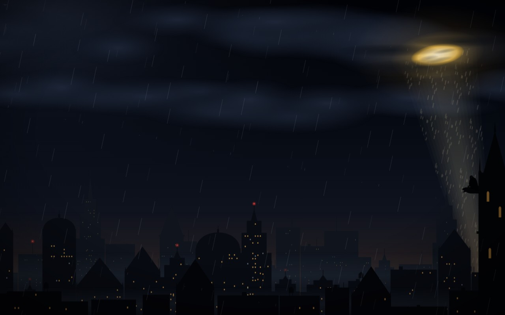
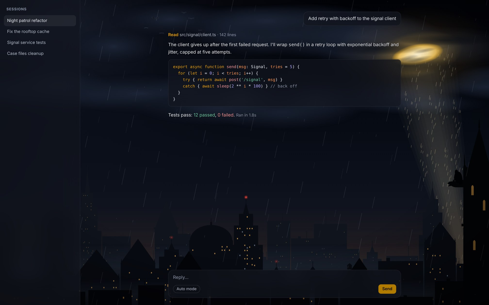

# Vigil

A dark theme for Claude Code, for a city that needs watching. Storm clouds hang low over a gothic skyline, and a searchlight lights the cloud base in gold. Rain falls through the beam, bats cross the light, and a cloaked figure keeps watch from a gargoyle at the edge of the frame.



Vigil draws in the **Claude desktop app** and the **Claude mobile apps**. The terminal, the IDE extensions and Claude Code on the web don't draw themes.

## Install

At the prompt of a Claude Code session in a terminal:

```
/plugin install vigil --marketplace Raul8900/theme-studio
```

Answer `y` to add the marketplace, then press Enter for the user scope. From a shell:

```
claude plugin install vigil --marketplace Raul8900/theme-studio
```

In the desktop app, where `/plugin` doesn't run: click **+** next to the prompt box, then **Plugins**, **Add marketplace** with `Raul8900/theme-studio`, then **Add plugin**.

A theme installed at the user scope from a terminal also loads in the local sessions the desktop app starts, and draws there. A cloud session viewed in a browser doesn't draw it.

## Three backdrops, one palette

| Backdrop | What you see |
| --- | --- |
| `animated` (default) | The searchlight sweeps the clouds, rain falls, mist drifts over the skyline, windows go dark and light up again, and beacons pulse on the spires. A small flock crosses the light now and then. |
| `still` | The same city, held at one moment, with nothing moving. |
| `plain` | No picture: a night-sky gradient behind the same colors. |

Switch between them:

- `/vigil` switches between animated and still.
- `/vigil animated`, `/vigil still` or `/vigil plain` picks one.
- In the desktop app, right-click an empty part of the conversation and choose **Vigil: hold the city still** (or **let the city move**).

Your choice is remembered for later sessions.

If nothing shows, run `/vigil status`. It lists the apps attached to the session and, if the theme isn't drawn, the reason the app gave.



*A mock-up: the scene rendered behind a sketch of the app's layout, not a screenshot. [Watch ten seconds of the animated city](../../previews/vigil/vigil-motion.mp4), including a flock of bats sent up by a click.*

## Details

- **Rain that catches the light.** On desktop the rain is drawn on the GPU, faint in the dark and bright wherever the city's own light falls on it: the beam, the lit clouds, windows and beacons. Rest the pointer on an empty part of the sky and the rain around it lights up as if under a lamp.
- **Click the sky.** In the animated city, clicking an empty part of the night sky sends a flock of bats up from that point.
- **Respects Reduce Motion.** With Reduce Motion on, the city is drawn still and the shader stays off.
- **Readable first.** Panels frost over the city in the palette's own blue-black. On every surface color in the palette, body text is at least 13.8:1, secondary text 8.8:1 and muted text 5.4:1. Code takes its colors from the theme: gold keywords, green strings, violet literals, rose names and amber variables.
- **Fits any window.** The searchlight and the watcher stay pinned to the right edge, and the skyline stays along the bottom, from a phone held upright to an ultrawide monitor.

The palette is dark only: blue-black stone, silver type and signal gold.

## Files

- `hooks/register.tsx`: sets the theme, the `/vigil` command, the right-click row, and drawing the backdrop.
- `hooks/look.ts`: the palette, built with the design system's `make-colors.js`.
- `hooks/scene.ts` and `hooks/art.ts`: the scene as SVG. `art.ts` is generated by `node tools/build-art.mjs hooks/art.ts`.
- `hooks/rain.ts`: the desktop rain shader.
- `tests/vigil.test.tsx`: run with `claude plugin test .`

All the art is original. It borrows a mood, not a logo or a character.
